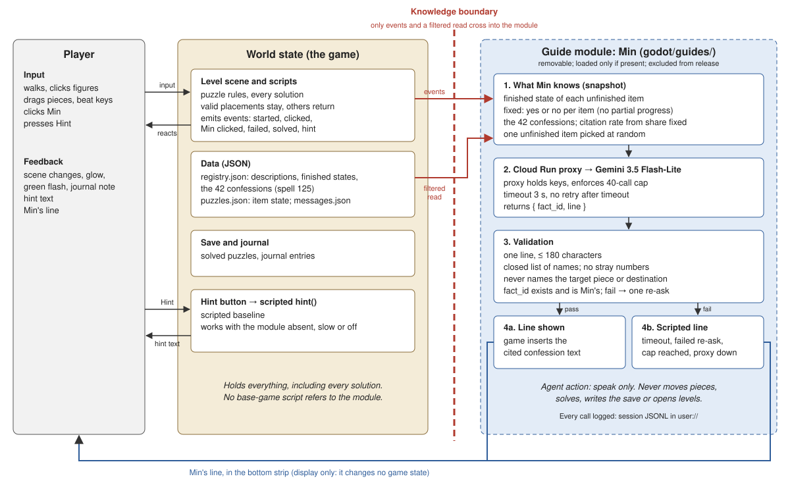

# Totenbuch: G1 Concept Pitch

Sources: [GDD](gdd.md), [Configuration Document](configuration.md) Section 4, [Risk Profile](risk.md), [Plan](plan.md).

---

## The X

Our game is a point-and-click walk along Lepsius's *Todtenbuch* papyrus (1842), where the player restores each scene of the scroll by looking closely at its drawn figures and putting right what is wrong, for the quiet pleasure of noticing.

---

## Player and motivation

- **For:** a curious adult or student who likes history but wants a more engaging way in; no Egyptology needed.
- **Motivation:** esteem and self-actualization, mastering an unfamiliar artefact. Competence: a puzzle solved by spotting. Autonomy: free walking and choice of order within a level.
- **If it works, a playtest shows:** the player's first click goes to a figure, not a piece; they read, then fix, and solve without the Hint button. With Min, they look at the item he fretted about and check his words against the drawing before acting.

---

## Core loop

1. **Act:** walk the scroll and click a figure or caption, or drag a piece.
2. **Respond:** the figure glows, a journal note and description appear; a placement stays or returns; the scene changes.
3. **Interpret:** notice what is wrong or what a figure asks for (a man holds a loaf instead of his goose).
4. **Next action:** fix it; the picture shows the progress, and the next scene opens.

---

## Pillars

1. **Nothing is redrawn.** Every figure comes from the plates; puzzles reuse what is drawn.
2. **Learn once, recall later.** What a level teaches comes back in a later level.
3. **The end is the Weighing of the Heart (125).** Earlier scenes give evidence used at the scale.

## Concepts considered

| Concept | Why not chosen |
|---|---|
| A standalone agent level on an unbuilt plate: the mound guardians (149), the seven cows (148), or the amulets (155–160) | Needs a new level and the agent in the same 13 days (Risk 1) |
| The strange creatures (163–165) as their own level | Same cost; as guides they reach every level instead |
| No agent: the scripted Hint button only | Leaves the course's agent question unasked |

**Why this one won:** a removable guide module runs in a level that is already built, so G2 tests the agent alone, against the Hint button in the same level, and can be switched off without touching the game.

---

## References and attribution

| Source | What we borrow | What we change | Terms |
|---|---|---|---|
| Lepsius, *Das Todtenbuch der Ägypter* (1842), Turin papyrus of Iufankh | Every figure and scene, spliced from 300-dpi plates | Cut, re-posed and recombined; never redrawn | Public domain. Digital edition credited to Dr. Marcus Müller (Totenbuch-Projekt, Bonn), UB Heidelberg / Propylaeum-DOK |
| C. H. S. Davis, *The Egyptian Book of the Dead* (1894) | Caption translations; the 42 Negative Confession declarations Min cites | Adapted and shortened; credited as adapted from Davis | Public-domain status to confirm |
| Old Fax font (George Blackwell) | All UI text | Unmodified | CC BY 4.0 |
| HUD borders and icons | UI frame | Made with Claude Code to match Old Fax | Ours |
| Our midterm (spells 31–32) | Vertex harness, Flash-Lite cost and latency figures, fallback pattern | Moved behind a Cloud Run proxy | Ours |
| Gemini 3.5 Flash-Lite on Vertex AI | Phrasing of Min's lines | Constrained to fact ids and a name list | Google Cloud terms; GCP credits |

**[To fill]** game references: specific games, moments or mechanics this borrows from.

---

## Systems diagram

- **World state** (left of the red line) holds everything, including every solution.
- **What Min knows** (right of it): the finished state of unfinished items, whether each is fixed (yes or no), and the 42 confessions. Nothing else crosses.
- **Agent action:** speak only. Validation checks every line; any failure gives a scripted line, and the Hint button works throughout.

---

## Agent hypothesis

- **Bounded behaviour:** Min, the scarab-bodied god (165), knows only the future: what each unfinished item looks like whole. Each time he is clicked he picks one unfinished item at random and frets over it as a wrong to avoid, citing a Negative Confession ("*I have not stolen the offerings*… we haven't, have we?"). He never names the piece or where it goes, cannot see half-done work, and frets a little more as the scene nears completion.
- **Experience it should affect:** noticing. His line points the player at the scene to check, not at the answer.
- **Hypothesis:** we expect Min, who knows only the future and is partly wrong, to help players solve puzzles by checking what he says against the scene, without giving the solution away, compared with the scripted Hint button.
- **Scripted baseline:** the Hint button and each level's scripted `hint()`.
- **Playtest question and test:** do players with Min solve more puzzles with fewer Hint presses, and do they act on the item he named? External playtesters play the G2 level, half with Min offered and half with only the Hint button; the session log shows whether players act on the item Min named and whether any line gave a fix away.
- **What the player loses with the scripted baseline:** Min answers what the player asks him, in character, about the scene as it is now. Scripted, he can only recite a fixed set of lines; once they repeat, the player stops clicking him and goes back to the Hint button, which tells rather than makes them look.

---

## Scope

- **Included:** the five built levels; the guide module with Min only, in one built level (which one is open); the Hint button as baseline; session logging, caps and fallback.
- **Excluded:** the snake (163) and the Ptah-dwarfs (164) and their choice-screen lines, until after G2; a new level for G2; art drawn from scratch; procedural levels; multiplayer; network access in the release build.
- **Cut first:** typed questions to Min (he keeps click-to-speak lines), then the model itself (Min speaks scripted lines only).

---

## Budgets

| | Number | Basis |
|---|---|---|
| Latency | Not yet measured; timeout 3 s per call, no retry, scripted line after | Midterm, same model: median 0.9 s, 95th percentile 2.5 s, for shorter replies. Min speaks only when clicked and nothing waits on him, so a slow reply costs a pause, not play |
| Cost per call | about $0.0016 uncached, $0.0010 cached | ~2,000-token prefix, ~1,500-token state and question, ~200 output tokens; $0.30 / M input, $2.50 / M output (confirmed 2026-11-15) |
| Cost per session | 40-call cap, about $0.07 at the cap | 40 calls, 20% re-asked, no caching |
| Course total | under about $10 | 20 playtest sessions (~$1.50) plus 5,000 development and evaluation calls (~$8); midterm spent $3.19 on 4,944 calls |

---

## Risk Profile

| Dimension | Rating | Evidence | Mitigation |
|---|---|---|---|
| **IP / Concept** | Low | Lepsius plates public domain; Old Fax CC BY 4.0; five levels built. Davis's status to confirm | Confirm Davis's status; credit as adapted |
| **Business / Audience** | Medium | Niche subject, unusual approach; two one-player playtests, both about difficulty and pace | Tune from playtest numbers, at least two players per decision |
| **Technology** | Medium | Midterm ran 4,944 Flash-Lite calls with labelled fallbacks; the Godot → Cloud Run → Vertex path and the export are untested; no CI here | Test proxy and export on another machine early; Hint button stays; build without the module as backup |
| **Team** | Medium | One person reviews every commit, art fix and gate; Producer, BI and Release artifacts planned | Narrow G2 to one agent in one built level |
| **Genre / Mechanics** | Medium | Core loop and minigames built and tested; graded hints, Min, and "look before acting" untested | G2 playtest tests exactly these |
| **Timeline** | **High** | 13 days to G2/G3 (Nov 30) including Thanksgiving; November pace 8 commits | **Mitigation:** Min only, in an already built level; the new level moves to after G3. Checked at the Nov 23 working session |

**How they combine:** Technology, Genre / Mechanics and Timeline all rest on one G2 build; putting Min into a built level lets one experiment answer all three.
